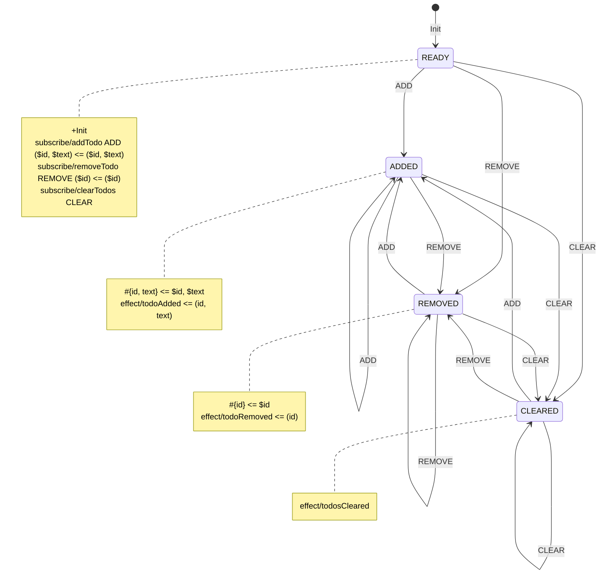

# Persistent Todo List

This example extends the [`Data Model` and `Effects` Counter](500_effect_counter.html)
with browser persistence. Todo items belong to the global `Data Model`. The `FSM` keeps command data in its `Context`
and copies it into the `Event Meta` that its `Effects` consume.

## `Data Model`

```ts
interface ITodoItem {
	id: string;
	text: string;
}

interface ITodoModel {
	items: Record<string, ITodoItem>;
}

type TTodoSnapshot = Pick<ITodoModel, 'items'>;

const defaultModel: ITodoModel = { items: {} };
```

The `Data Model` is a plain snapshot. `ModelStore` owns it in memory, while the
`Storage` binding below persists only the `items` projection.

## `FSM` and `Effects`



Generate a TypeScript `FSM` named `TodoFlow`. The generated `Slice` factory
requires one `Model Transformer` for each declared `Effect`.

```ts
import {
	CoreLoop,
	EffectScheduler,
	hydrateModel,
	ModelStore,
	StorageSyncLoop,
	type TStorageBinding,
} from '@yantrix/core';
import { LocalStorageAdapter } from '@yantrix/storage';
import {
	createTodoFlowSlice,
	eventDictionary,
} from './generated/TodoFlow.js';

const todoStorage = new LocalStorageAdapter<TTodoSnapshot>({
	id: 'todo-list',
	key: 'yantrix:todo-list:v1',
});

const todoBinding: TStorageBinding<ITodoModel, TTodoSnapshot> = {
	storage: todoStorage,
	select: model => ({ items: model.items }),
	hydrate: (model, snapshot) => ({ ...model, items: snapshot.items }),
};

// Hydrate before constructing the store and the `Main Loop`.
const hydration = await hydrateModel(defaultModel, [todoBinding]);
for (const failure of hydration.failures) {
	console.error('Todo hydration failed', failure);
}

const modelStore = new ModelStore(hydration.model, {
	development: { freeze: true, validateSerializable: true },
});
const effectScheduler = new EffectScheduler<
	ITodoModel,
	number,
	Record<number, unknown>
>({ store: modelStore });
const coreLoop = new CoreLoop<
	number,
	Record<number, unknown>,
	ITodoModel
>({ effectScheduler });

const todoSlice = createTodoFlowSlice<ITodoModel>({
	todoAdded: (event, model) => {
		const id = String(event.meta?.id ?? '');
		const text = String(event.meta?.text ?? '');
		if (id.length === 0 || text.length === 0) return model;
		return {
			...model,
			items: { ...model.items, [id]: { id, text } },
		};
	},
	todoRemoved: (event, model) => {
		const id = String(event.meta?.id ?? '');
		if (!Object.hasOwn(model.items, id)) return model;
		const items = { ...model.items };
		delete items[id];
		return { ...model, items };
	},
	todosCleared: (_event, model) => Object.keys(model.items).length === 0
		? model
		: { ...model, items: {} },
});

coreLoop.registerSlice(todoSlice).start();

const storageSync = new StorageSyncLoop({
	store: modelStore,
	bindings: [todoBinding],
	session: hydration.session,
	debounceMs: 150,
	onError: failure => console.error('Todo persistence failed', failure),
}).start();

// Persist defaults or a successfully migrated snapshot even before a command.
storageSync.requestSync();
```

`LocalStorageAdapter` can accept an injected `storage`, `serialize` and
`deserialize`, which makes the same composition testable without browser
globals.

## UI commands and rendering

The UI publishes commands and renders committed `Data Model` snapshots. It never
edits the `FSM` `Context` or `Storage` directly.

```ts
function render(model: ITodoModel): void {
	// Replace this with React, DOM, CLI or an API `Destination`.
	console.table(Object.values(model.items));
}

render(modelStore.get());
const stopRendering = modelStore.subscribe(render);

let acceptingCommands = true;

async function dispatchCommand(event: number, meta: Record<string, unknown> | null): Promise<void> {
	if (!acceptingCommands) throw new Error('Todo list is shutting down');
	coreLoop.getBus().dispatch({ event, meta });
	await coreLoop.whenIdle();
}

export function addTodo(id: string, text: string): Promise<void> {
	return dispatchCommand(eventDictionary.addTodo, { id, text });
}

export function removeTodo(id: string): Promise<void> {
	return dispatchCommand(eventDictionary.removeTodo, { id });
}

export function clearTodos(): Promise<void> {
	return dispatchCommand(eventDictionary.clearTodos, null);
}

async function shutdown(): Promise<void> {
	acceptingCommands = false;
	try {
		await coreLoop.whenIdle();
	} finally {
		stopRendering();
		coreLoop.unregisterSlice(todoSlice.id);
		coreLoop.stop();
		await storageSync.stop(true);
	}
}
```

`coreLoop.whenIdle()` waits for the command's `Event` cascade and `Effect` batch. Persistence is
asynchronous. During shutdown, stop accepting commands and drain the running `Main Loop` before
disconnecting the `Slice`. Flush the `Sync Loop` to persist the final committed snapshot.

```ts
await addTodo('first', 'Try Yantrix Effects');
await storageSync.whenIdle();
```

Reloading the application repeats `hydrateModel()` and restores the saved
`items` projection before the UI and `Main Loop` start.
