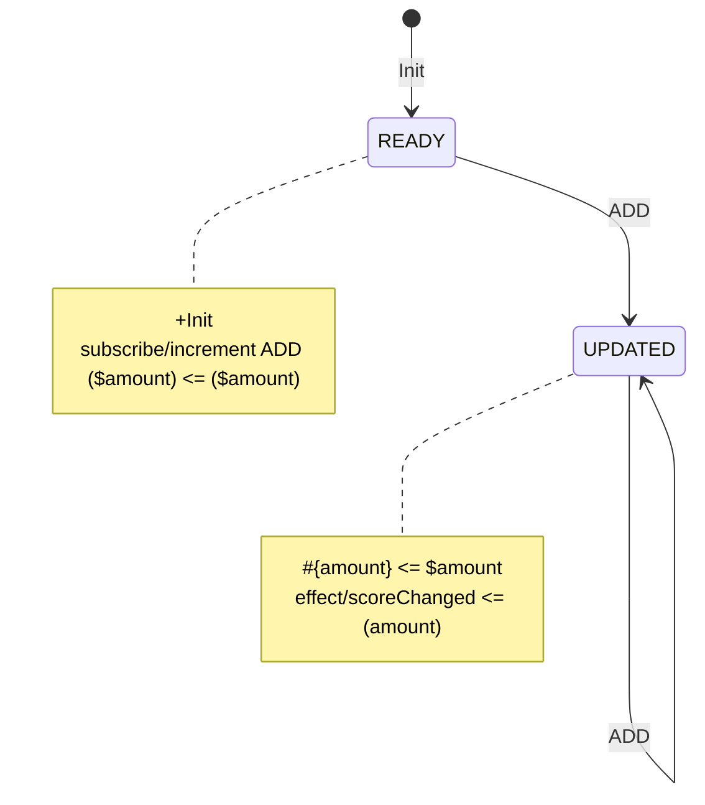

# `Data Model` and `Effects` Counter

This minimal end-to-end example uses generated `FSM` code, a `Slice`, the `Main Loop`,
an `Effect` and the `Data Model`. The [Todo example](1000_todo.html) adds the `Storage` lifecycle.

## Diagram



Generate TypeScript with class name `CounterFlow`. The generated module exports
`eventDictionary`, `createCounterFlowEffectMatrix()` and
`createCounterFlowSlice()`.

## Composition root

```ts
import {
  CoreLoop,
  createModelFunctions,
  EffectScheduler,
  ModelStore,
} from '@yantrix/core';
import {
  createCounterFlowSlice,
  eventDictionary,
  type TCounterFlowEffectEvent,
  type TCounterFlowEventMeta,
} from './generated/CounterFlow.js';

interface CounterModel {
  score: number;
  maximum: number;
}

const initialModel: CounterModel = { score: 0, maximum: 10 };
const modelStore = new ModelStore(initialModel, {
  development: { freeze: true, validateSerializable: true },
});

const fx = createModelFunctions<CounterModel, TCounterFlowEffectEvent, TCounterFlowEventMeta>();
const scoreChanged = fx.forEvent<typeof eventDictionary.scoreChanged>();
const belowMaximum = scoreChanged.predicate(
  model => model,
  (_event, model) => model.score < model.maximum,
);

const addScore = scoreChanged.transformer(
  model => model.score,
  (model, score) => ({ ...model, score: Math.min(model.maximum, score) }),
  (event, score) => {
    const amount = event.meta?.amount;
    if (typeof amount !== 'number') return score;
    const nextScore = score + amount;
    return Number.isFinite(nextScore) ? nextScore : score;
  },
);

const counterSlice = createCounterFlowSlice<CounterModel>({
  scoreChanged: scoreChanged.when(belowMaximum, addScore),
});
const effectScheduler = new EffectScheduler({ store: modelStore });
const coreLoop = new CoreLoop({ effectScheduler });
coreLoop.registerSlice(counterSlice).start();

coreLoop.getBus().dispatch({
  event: eventDictionary.increment,
  meta: { amount: 3 },
});
await coreLoop.whenIdle();

console.info(modelStore.get()); // { score: 3, maximum: 10 }
```

The external `increment` `Event` drives an `FSM` transition. Entering `UPDATED`
emits `scoreChanged`. Its entry in the generated `Effect Matrix` updates the `Data Model`.
`whenIdle()` covers both steps and the `Effect` commit.

## What to test

```ts
import assert from 'node:assert/strict';

assert.equal(modelStore.get().score, 3);
modelStore.subscribe((next, previous) => {
  // One command may run several `Effects`, but the batch commits once.
  console.info({ next, previous });
});

coreLoop.getBus().dispatch({
  event: eventDictionary.increment,
  meta: { amount: 100 },
});
await coreLoop.whenIdle();

assert.equal(modelStore.get().score, 10);
```

The `Model Predicate` guards the score limit. Adding zero also preserves the snapshot, so neither case
notifies subscribers.
