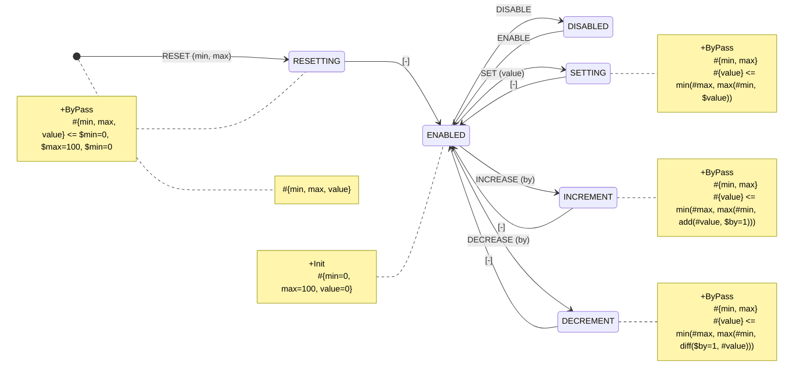
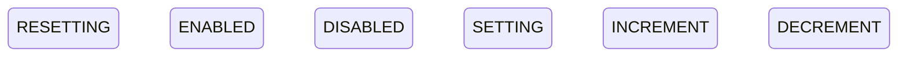
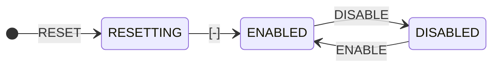
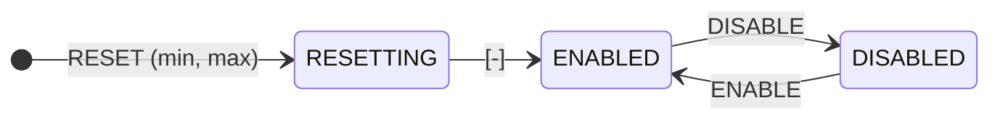
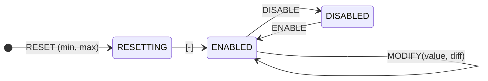
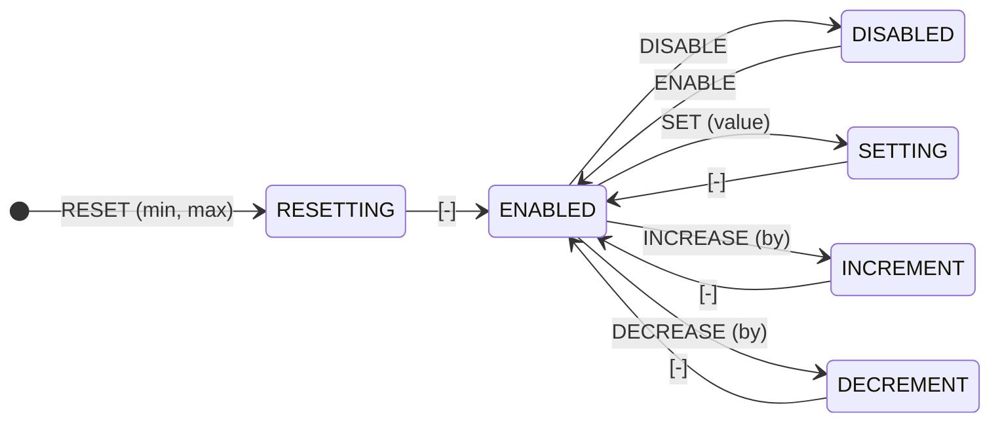
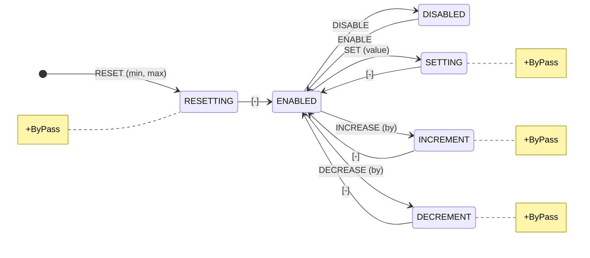
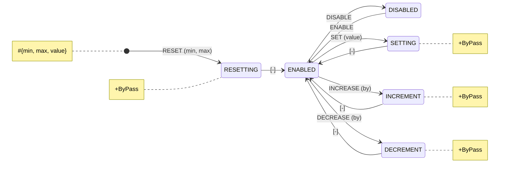
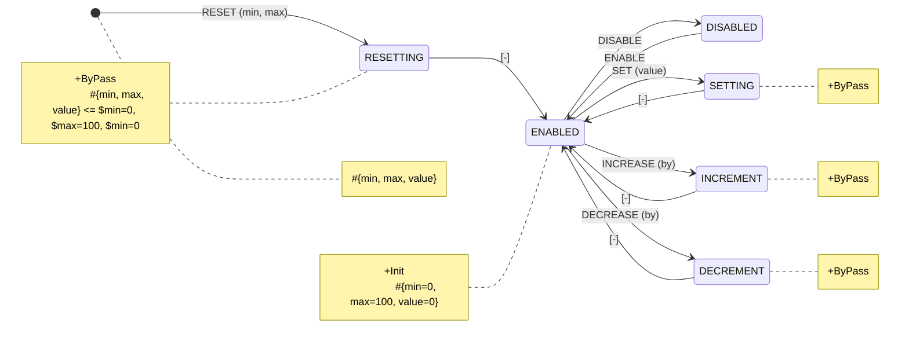
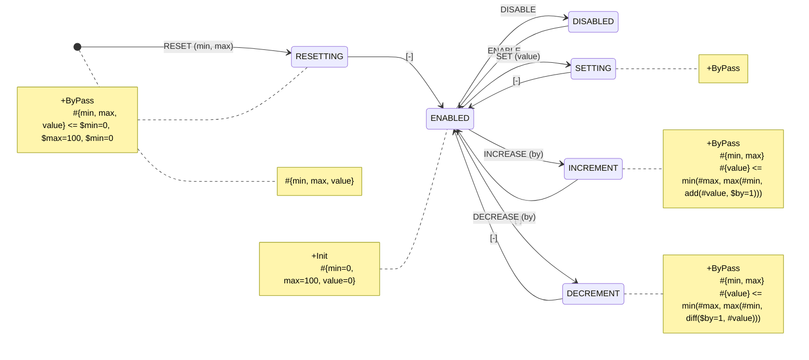

# Yantrix

Yantrix is a TypeScript framework that provides a set of tools to create robust and self-documented functional applications by code generation.
The business logic is represented by declarative, event-driven [finite state machines](https://en.wikipedia.org/wiki/Finite-state_machine), while the application state is an [Anemic Domain Model](https://en.wikipedia.org/wiki/Anemic_domain_model), making it great a counterpart to any traditional state manager like [Redux](https://redux.js.org/), while allowing devs to focus on describing contracts and workflows, rather than writing and debugging the
actual code.

Lends itself perfectly to Architecture-as-Code paradigm and no-code/less-code tools for developers, like [n8n](https://github.com/n8n-io/n8n).

## Quick Start

Let's build a slider component. First, we need a diagram for a State Machine describing its behaviour. The diagram is written in [Yantrix subsyntax](./syntax/) of [Mermaid](https://mermaid.js.org/) and can be visualized directly with that awesome library. Click on `<>` button to see the source code:



Save the diagram as `slider.mermaid`. Install the CLI and the runtime, then generate the TypeScript class in your project.

```shell
npm install @yantrix/core
npm install --save-dev @yantrix/cli
npx yantrix codegen ./slider.mermaid --outfile slider_controller.ts --language typescript --className Slider
```

The following TypeScript module creates one slider and exports handlers you can bind to UI controls. The position passed to `setPosition` is a fraction of the range, so `setPosition(0.5)` selects the midpoint.

```typescript
import Slider from './slider_controller.js';

const min = -1000;
const max = 1000;
export const slider = new Slider();
slider.dispatch(Slider.createAction('RESET', { min, max }));

export const moveRight = () => slider.dispatch(Slider.createAction('INCREASE', { by: 50 }));
export const moveLeft = () => slider.dispatch(Slider.createAction('DECREASE', { by: 50 }));
export const setPosition = (fraction: number) =>
	slider.dispatch(Slider.createAction('SET', { value: min + fraction * (max - min) }));
export const getValue = () => slider.getContext().context.value;
export const isDisabled = () => Slider.hasState(slider, 'DISABLED');
```

The `.js` import above points to the JavaScript emitted by TypeScript. You can also connect the generated class to [React or Redux](./integrations/).

## Syntax Breakdown

Let's see what's happening in depth. The diagram describes an [`FSM`](concepts/200_FSM.html), &mdash; a finite state machine, a control object that is characterized by a limited set of `States`, and it always resides in one and only one of them.

### States

Every `State` is independent on another and difference between `States` is _qualitative_, i.e. they represent some scenarios in App that are independent on each other and never happen simultaneously:

-   Slider is resetting the range and its value
-   Slider is usable and idle (enabled)
-   Slider can't be interacted with (disabled)
-   Slider is being switched to a particular position
-   Slider is being nudged left or right



### Actions

To change the `State` of the machine, an `Action` must be invoked. Every `Action` has a unique name, and the first layer of diagram is essentially a graph that depicts which `Actions` lead to which `States`.



Also note that not every `Action` can be invoked from every `State` by default. A `[*]` node is used to define an `Action` that can be invoked from every `State`. The binding between `States` and `Action` define a [many-to-many relation](https://en.wikipedia.org/wiki/Incidence_matrix), called `Transition Matrix`, that is another way to define the `FSM`. Every item in this matrix is either null or an `Action` name, while columns and rows correspond to `States` in the same order.

| From/To      | ENABLED | DISABLED | RESETTING |
| ------------ | ------- | -------- | --------- |
| _any_        |         |          | RESET     |
| **RESETTING** | [-]     |          |           |
| **ENABLED**  |         | DISABLE  |           |
| **DISABLED** | ENABLE  |          |           |

### Payload

Every `Action` can carry a `Payload`, which is a plain data object that represents some meta-information about the change requested by it. For instance, when resetting (instantiating) a Slider, it's wise to provide its min and max values. `Payload` fields are listed in parentheses on the action. The reducer reads these fields with `$` and can supply a default, as in `$min=0`.



Technically, nudging Slider can be processed the same way as setting it directly, by an only `Action`, carrying a polymoprhic `Payload`, allowing to either adjust value or to set it directly:



However, different behaviours are better to be represented with different `States`.

### Intermediary States

While `FSM` is transactional and synchronous (i.e. no further computation is done until the invoked `Action` has been processed), most interactions are asynchronous by nature, and they have some in-between state, usually called "pending" in this context.

In fact, even synchronous operations could have an intermediate `State` which actually does computations, and this would be an advised design pattern. As you can guess, those operations then could be easily plugged in with async functionality, behaving as a [Promise](https://developer.mozilla.org/en-US/docs/Web/JavaScript/Reference/Global_Objects/Promise).



here we define 3 `Actions` and 3 corresponding intermediate `States` for them:

-   `SET (value)` &ndash; a direct assignment of the Slider value, leading to **SETTING** `State` and carrying new value in `Payload`
-   `INCREASE (by)` &ndash; an increment of the Slider value, leading to **INCREMENT** `State` and carrying a difference in `Payload`
-   `DECREASE (by)` &ndash; a decrement of the Slider value, leading to **DECREMENT** `State` and carrying a difference in `Payload`

Here we use `[-]` labels on `Actions`, which is a special symbol for [ByPass](/syntax/100_data_objects.html#bypass) `Action`. Now, to emphasize that we need to add _Notes_ to `States` to describe their behaviour:



Our Transition Matrix now looks like this:

| From/To   | ENABLED | DISABLED | RESETTING | INCREMENT | DECREMENT | SETTING |
| --------- | ------- | -------- | --------- | --------- | --------- | ------- |
| _any_     |         |          | RESET     |           |           |         |
| ENABLED   |         | DISABLE  |           | INCREASE  | DECREASE  | SET     |
| DISABLED  | ENABLE  |          |           |           |           |         |
| RESETTING | [-]     |          |           |           |           |         |
| INCREMENT | [-]     |          |           |           |           |         |
| DECREMENT | [-]     |          |           |           |           |         |
| SETTING   | [-]     |          |           |           |           |         |

### Context

Now, we need to define `Context` &mdash; values that are stored within `FSM` along with the current `State` and represent some of its _quantitative_ properties. We define it with [Reducers](./syntax/110_reducers.html) along with `State`, and they are calculated whenever the `FSM` is switched to that `State`. The reducer on `[*]` makes the previous `min`, `max` and `value` available to each destination reducer. When an operation computes a new `value`, its `#{min, max}` also copies both bounds into the new context.



The slider tracks three context properties.

-   **value** stores current Slider position
-   **min** stores minimal selectable value
-   **max** stores maximal selectable value

### Initial Context

The **RESET** action enters **RESETTING**. Its reducer reads the bounds from the payload, using defaults of `0` and `100`, and sets the new value to the lower bound. Supply bounds with `min <= max`. The bypass returns the slider to **ENABLED**, including when it was disabled before the reset.



The [Init flag](./syntax/100_data_objects.html#init) starts a new slider in **ENABLED**. Its reducer supplies the initial bounds and value, and copies them on later entries.

### Operations on data

Now we specify the arithmetics for intermediate "nudge" `States` **INCREMENT** and **DECREMENT**, which will add or substract, respectively, the provided `Payload` property **by** to/from stored **value** in `Context` :



An omitted `$by` defaults to `1` in each reducer, while an explicit `0` leaves the value unchanged. We use built-in [Transformer Functions](./syntax/160_transformers.html) `min`,`max`,`add` and `diff` here in such a manner, that the resulting **value** always stays within **min** and **max** bounds.

Finally, the **SETTING** reducer clamps the value from the payload and stores it in context.


Now, it's only about dispatching proper `Payloads` to the `FSM`.

## What's next?

-   See [Sample FSM Designs](./concepts/999_design_examples.html) and [generate some code](./API/codegen)
-   Learn Yantrix [Syntax](./syntax) and try making an `FSM` of your own
-   Try some [Integrations](./integrations) with your favorite frameworks to achieve fast results
-   Read more on [framework architecture](./concepts) and how to expand beyond one `FSM` into `Slice`s and built a whole `Application` on Yantrix
-   If you like what you get, consider [Contributing](./contributing) or resolving some [Issues](https://github.com/tfcp68/yantrix/issues)
