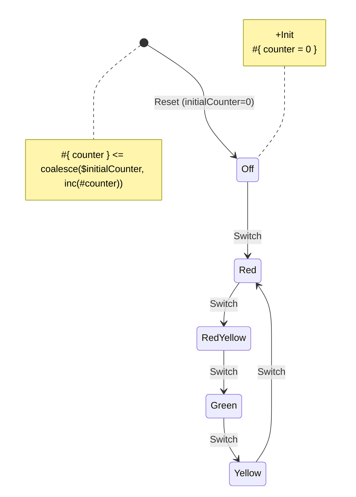

# Integrating with React

`@yantrix/react` provides `useFSM` and `useFSMWithSelector` for components that subscribe to a generated FSM instance.

## Setup

In a React application, install the adapter and the runtime used by generated TypeScript machines. The adapter uses the application's existing React installation as a peer (`^18.3.1 || ^19.0.0`). Applications that use only `@yantrix/core` can omit React and the adapter.

```shell
npm install @yantrix/react @yantrix/core
npm install --save-dev @yantrix/cli @yantrix/codegen @types/node
```

The generated TypeScript includes a timing helper that also runs on Node. Its `process` reference uses the Node type declarations during compilation.

Save the traffic light diagram as `schemas/traffic-light.mermaid`:



Generate the TypeScript class from the project root:

```shell
npx yantrix codegen schemas/traffic-light.mermaid --outfile src/generated/traffic-light.ts --language TypeScript --className TrafficLight
```

## Hook

Create a machine once for the lifetime of the component and pass the instance to `useFSM`. The hook subscribes to state and context changes. Action and state names match the case used in the diagram.

```tsx
import { useState } from 'react';
import { useFSM } from '@yantrix/react';
import TrafficLight from './generated/traffic-light.js';

export function TrafficLightButton() {
    const [machine] = useState(() => new TrafficLight());
    const { dispatch, getContext, state } = useFSM<{ counter: number }>(machine);
    const isRed = state === TrafficLight.getState('Red');

    return (
        <button
            className={isRed ? 'red' : 'other'}
            onClick={() => dispatch(TrafficLight.createAction('Switch', {}))}
        >
            Switch ({getContext().context.counter})
        </button>
    );
}
```

## Multiple instances

The generator sets `TrafficLight.id` to the class name plus a generation-time timestamp. All instances of that generated class share this value. Within a hook result, `id` exposes the same static class ID. When starting from an instance in TypeScript, `(machine.constructor as typeof TrafficLight).id` reads the static property.

Each `new TrafficLight()` gets its own `machine.correlationId`. To give the instance a readable name in the React registry, pass `{ name: 'north' }` to `useFSM`, or add `name` alongside `selector` in `useFSMWithSelector`. Without a name the registry uses `machine.correlationId`. The hook's `getInstanceAutomata().id` returns the effective registry key. Its top-level `id` still identifies the class.

Pass the same machine to components that should observe the same light. They reuse its current registration until the last subscriber unmounts. If a different live machine requests an occupied name, the adapter warns and uses that machine's own `correlationId`. Use distinct names for independent lights.

```tsx
import { useState } from 'react';
import { useFSM, useFSMWithSelector } from '@yantrix/react';
import TrafficLight from './generated/traffic-light.js';

type LightProps = { machine: TrafficLight; name?: string };

function SwitchButton({ machine, name }: LightProps) {
    const { dispatch, createAction } = useFSM(machine, { name });
    return <button onClick={() => dispatch(createAction('Switch', {}))}>Switch</button>;
}

function Counter({ machine, name }: LightProps) {
    const { selection } = useFSMWithSelector(machine, {
        name,
        selector: (light): number => light.getContext().context.counter,
    });
    return <output>{selection}</output>;
}

export function TrafficLightPanel({ name }: { name?: string }) {
    const [machine] = useState(() => new TrafficLight());
    return (
        <>
            <SwitchButton machine={machine} name={name} />
            <Counter machine={machine} name={name} />
        </>
    );
}
```

For example, `<TrafficLightPanel name="north" />` and `<TrafficLightPanel name="south" />` own independent lights. Inside either panel, pressing the button updates its sibling counter. `useFSMWithSelector` re-renders its subscriber when the selected value changes. For selectors returning objects, you can supply `isEqual(previous, next)` to reuse a logically equal selection.

## Dictionaries

The hook exposes the generated class's `getState`, `getAction`, and `createAction` helpers. For example, `getState('Red')` returns the numeric state ID, and `createAction('Switch', {})` builds the action and payload accepted by `dispatch`.

## Debugging

Call `trace()` on the same hook that dispatched the action to inspect its last payload and previous state/context. Use `getContext()` for the current state/context. Each call to `trace()` assigns the diagnostic record its own ID and timestamp.

```tsx
import { useFSM } from '@yantrix/react';
import TrafficLight from './generated/traffic-light.js';

export function DebugSwitch({ machine }: { machine: TrafficLight }) {
    const { dispatch, createAction, trace, getContext } = useFSM(machine);

    function advance() {
        dispatch(createAction('Switch', {}));
        const { lastPayload, previousContext } = trace();
        console.log(lastPayload, previousContext, getContext());
    }

    return <button onClick={advance}>Switch and log</button>;
}
```
