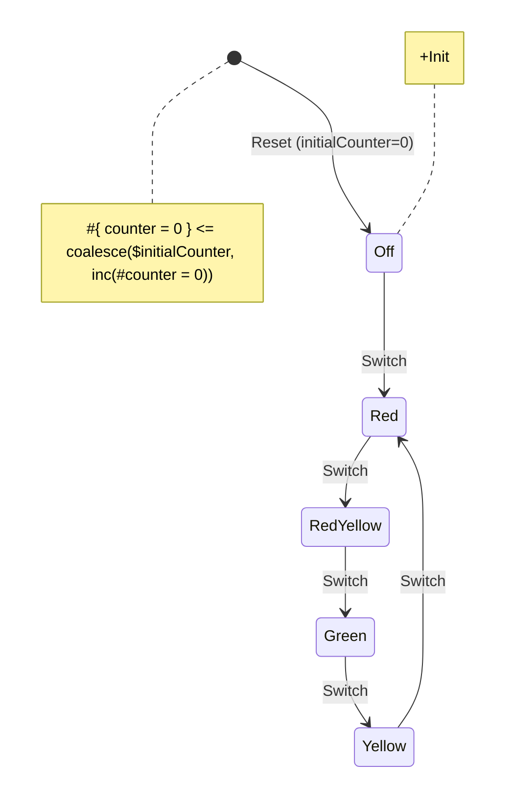
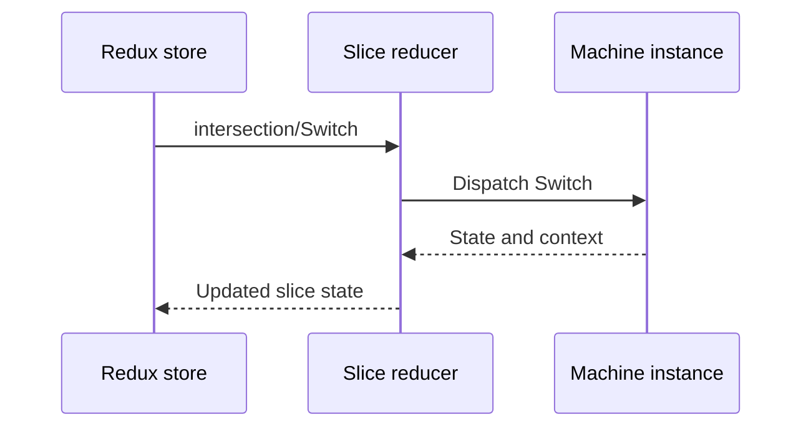
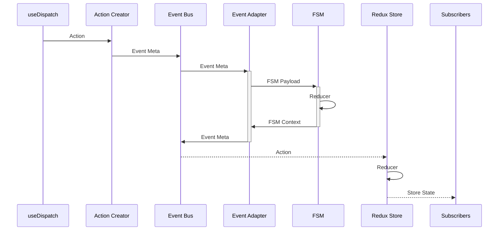

# Integrating with Redux

Install the Redux adapter and its Redux Toolkit peer in the application that owns the store.
The generated machine imports its runtime from `@yantrix/core`. An application using only
that runtime can omit the Redux adapter, Redux Toolkit, and React.

```shell
npm install @yantrix/core @yantrix/redux @reduxjs/toolkit@^2.2.7
```

If you generate TypeScript from diagrams in this project, install the generation tools as development dependencies.

```shell
npm install --save-dev @yantrix/cli @yantrix/codegen
```

## Setup

Save this diagram as `schemas/traffic-light.mermaid`.



Generate the TypeScript class from the project root.

```shell
npx yantrix codegen schemas/traffic-light.mermaid --outfile generated/traffic-light.ts --language TypeScript --className TrafficLight
```

## RTK Slice

`createFSMSlice` accepts an options object. Pass the generated **constructor** as `Fsm` and choose
the slice `name`. Each call creates a machine instance. Redux Toolkit uses the name to prefix the
slice's action types. The key supplied to `configureStore` determines where the reducer's state
lives in the store.



### API

```typescript
import { configureStore } from '@reduxjs/toolkit';
import { createFSMSlice } from '@yantrix/redux';
import TrafficLight from './generated/traffic-light.js';

const signals = createFSMSlice<keyof typeof TrafficLight.actions, object>({
    Fsm: TrafficLight,
    name: 'intersection',
    reducerPath: 'signals',
});
const store = configureStore({ reducer: { signals: signals.reducer } });

const switchLight = signals.actions.Switch({});
console.log(switchLight.type); // 'intersection/Switch'
store.dispatch(switchLight);
console.log(store.getState().signals.state === TrafficLight.getState('Red')); // true
```

### State

`reducerPath` tells the slice's generated selectors where to look in the root state. The example
mounts the reducer under the same key, `signals`. It can have a different name from the action
prefix, `intersection`.

### Actions

The action type combines the slice name and the diagram's case-sensitive action name. Dispatch
`signals.actions.Switch({})` to send `intersection/Switch` to all reducers handling that type.

### Identifiers

| Value | Identifies | Example |
| --- | --- | --- |
| `TrafficLight.id` | The generated class. Instances of this generation share the value. Regenerating code can change its timestamp suffix. | `TrafficLight_<generation timestamp>` |
| `new TrafficLight().correlationId` | One machine instance. Constructing a second traffic light gives it a separate key. | Used by the [React integration](199_react.html) to locate the instance. |
| `signals.name` | The application-chosen Redux action prefix. | `intersection` produces `intersection/Switch` and `intersection/Reset`. |

For `const light = new TrafficLight()`, `light.constructor === TrafficLight`. Read the class
identifier as `TrafficLight.id` and the instance key as `light.correlationId`. You can pass
`TrafficLight.id` as the slice `name` explicitly. Choose a stable application name when Redux
actions are persisted, or distinct names when two independently routed slices use the same class.

## Middleware

Use `createMiddleware` to connect existing Redux actions to a generated machine. Pass the
constructor, an input mapper that selects the actions the machine should receive, and an output
mapper that converts the machine's resulting state and context into a Redux action. Returning
`null` from the input mapper lets an unrelated action continue through Redux.

This example is an alternative to the slice above. Dispatching `advance()` moves the traffic
light to Red. The Redux reducer records the resulting numeric state.

```typescript
import { configureStore, createAction, createReducer } from '@reduxjs/toolkit';
import { createMiddleware } from '@yantrix/redux';
import TrafficLight from './generated/traffic-light.js';

const advance = createAction('signals/advance');
const observed = createAction<number | null>('signals/observed');

const lightMiddleware = createMiddleware(
    TrafficLight,
    action => advance.match(action) ? TrafficLight.createAction('Switch', {}) : null,
    snapshot => observed(snapshot.state),
);
const initialState: { color: number | null } = { color: null };
const reducer = createReducer(initialState, builder => {
    builder.addCase(observed, (state, action) => {
        state.color = action.payload;
    });
});
const store = configureStore({
    reducer,
    middleware: defaults => defaults().concat(lightMiddleware),
});

store.dispatch(advance());
console.log(store.getState().color === TrafficLight.getState('Red')); // true
```

## Event Adapters

For an application with several machines, a Redux store can observe their events through the
[Event Bus](../concepts/300_event_model.html). This is a separate integration pattern.
The application maps selected Redux actions to events, then dispatches Redux actions when
subscribed events arrive.


