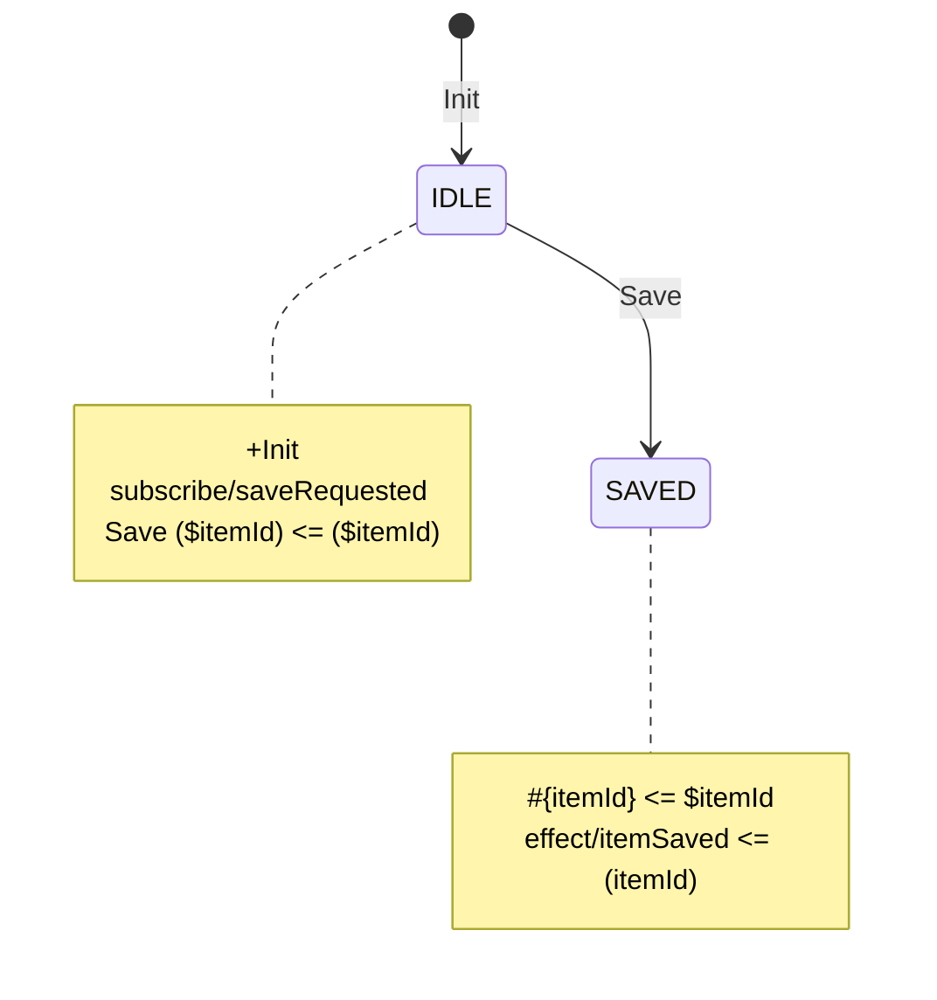

# Side Effects

`Effects` are pure functions that take `Data Model` and `Event Meta` as parameters and return updated `Data Model`. Every `FSM` is locked onto oneself and cannot directly update the "outer world data" that is expressed by `Data Model`. To do so, `Effects` are invoked by `Event Stack` every time it repeats its cycle.

While every `FSM` can declare its own `Effects`, in fact they are invoked all at once, when (if) all `FSM`s have been already done with their `Reducer` loops and some `Events` have been emitted by `Event Adapters`. Only the emitted `Events` would be translated to `Effects`.

```
effect/<EFFECT_NAME> [<= (<META_KEY_LIST>)]
```

When an `FSM` enters a `State` with an `effect/` declaration, its `Event Adapter` emits the named `Event`.
The optional key list copies values from the new `Context` into `Event Meta`. Within a diagram, every `effect/`
or `emit/` that produces that `Event` must supply the same named keys. Their order can differ.

In `SaveFlow`, the `saveRequested` `Event` supplies `itemId` to the `Save` `Action`. On entry to `SAVED`, the `Reducer`
copies `itemId` from the `Action Payload` into `Context`. The `Event Adapter` then emits `itemSaved` with that value
in `Event Meta`.



JavaScript and TypeScript codegen export `create<ClassName>EffectMatrix()` and `create<ClassName>Slice()`.
The application supplies each `Model Transformer` by name. Here, the `itemSaved` handler writes the ID to the `Data Model`.

```ts
import { CoreLoop, EffectScheduler, ModelStore } from '@yantrix/core';
import { createSaveFlowSlice, eventDictionary } from './SaveFlow.js';

type TSaveModel = { lastSavedId: number | null };

const store = new ModelStore<TSaveModel>({ lastSavedId: null });
const loop = new CoreLoop({ effectScheduler: new EffectScheduler({ store }) });
const slice = createSaveFlowSlice<TSaveModel>({
	itemSaved: (event, model) => typeof event.meta?.itemId === 'number'
		? { ...model, lastSavedId: event.meta.itemId }
		: model,
});

loop.registerSlice(slice).start();
loop.getBus().dispatch({ event: eventDictionary.saveRequested, meta: { itemId: 42 } });
await loop.whenIdle();
console.info(store.get().lastSavedId); // 42
loop.stop();
```

TypeScript codegen exports the declared `Event` IDs, their `Event Meta` keys, and the `Model Transformer` registry type.
The factory accepts the application's `Data Model` type and defaults to `Record<string, unknown>`.

In the TypeScript runtime an `Effect` has the `(event, readonlyModel) => nextModel` contract. A
[`Model Transformer`](160_transformers.html#model-transformers) has that shape. `whenModel` combines one with a
[`Model Predicate`](150_predicates.html#model-predicates) when a conditional `Effect` is required. The `Effect Scheduler`
applies matching `Effects` in order and commits at most one resulting snapshot for the complete `Main Loop` batch.

See [Language support](../integrations/100_language_support.html) for the dialects that generate `effect/` declarations.
Generating a diagram that uses `effect/` with an unsupported dialect reports an error.
